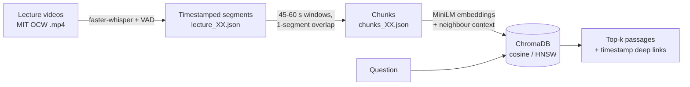

# Timestamped Lecture Q&A (RAG over video)

Ask a question about a lecture series and get back the exact moment in the video where it is answered.

The pipeline transcribes lecture videos with **Whisper**, cuts the transcript into overlapping, timestamped chunks, embeds them into a **ChromaDB** vector store, and returns the best-matching passages with a deep link (`video_url#t=<seconds>`) that opens the video at the right second.

**Dataset:** 12 lectures of MIT OpenCourseWare *6.0001 Introduction to Computer Science and Programming in Python* (Fall 2016), about 9 hours of video, resulting in **828 indexed chunks**.

   

## How it works



| Step | Script | What it does |
|------|--------|--------------|
| 1. Transcribe | `transcribe.py`, `main.py` | faster-whisper (`base`, CPU, int8) with voice-activity detection to skip silence. Writes timestamped segments per lecture; `main.py` batch-processes all lectures and skips finished ones. |
| 2. Chunk | `chunk.py` | Merges segments into 45–60 s windows with one segment of overlap, so answers that span a boundary are not lost. |
| 3. Index | `index.py` | Embeds each chunk together with the lecture title and ~200 characters of neighbouring text (a simple form of *contextual retrieval*), but stores the clean text for display. Rebuilds idempotently, so re-runs never duplicate. |
| 4. Search | `search.py` | Returns the top-k passages with similarity score, lecture title, `mm:ss` timestamp and a clickable link to that moment. |

### Example

```bash
python search.py "what is aliasing in python lists?" 3
```

Each hit is printed as:

```
[distance] <lecture title>  @ mm:ss
        <video_url>#t=<seconds>        <- opens the video at that moment
        <first ~220 characters of what the lecturer said>...
```

## Quick start

```bash
python -m venv .venv
.venv\Scripts\activate          # Windows  (Linux/macOS: source .venv/bin/activate)
pip install -r requirements.txt

# put the lecture videos in data/ as MIT6_0001F16_Lecture_XX_300k.mp4
python main.py                  # transcribe all lectures
python chunk.py                 # build timestamped chunks
python index.py                 # build the Chroma index in db/
python search.py "how does bisection search work?"
```

Videos, transcripts and the vector database are kept out of git (`data/`, `db/`).

## Roadmap

- [x] Whisper transcription with VAD, batch processing
- [x] Timestamp-preserving overlapping chunking
- [x] Persistent vector index with metadata and deep links
- [ ] Grounded LLM answers that cite the retrieved timestamps (and say so when the answer is not in the lectures)
- [ ] FastAPI backend (`POST /ask`, `GET /health`) and a small web UI with an embedded player
- [ ] Full contextual retrieval: LLM-written chunk context, hybrid BM25 + vector search with rank fusion, optional reranker
- [ ] Retrieval evaluation (hit@5, MRR) on a hand-labelled question set
- [ ] Docker image

## Content licence

Lecture content: [MIT OpenCourseWare 6.0001](https://ocw.mit.edu/courses/6-0001-introduction-to-computer-science-and-programming-in-python-fall-2016/), © MIT, licensed under [CC BY-NC-SA 4.0](https://creativecommons.org/licenses/by-nc-sa/4.0/). This project is non-commercial, and any derived transcripts are shared under the same licence. Only openly licensed videos are used.
